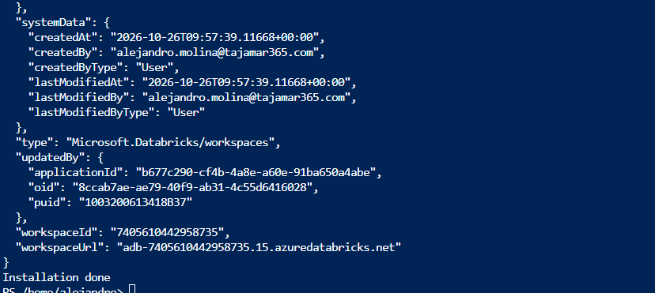
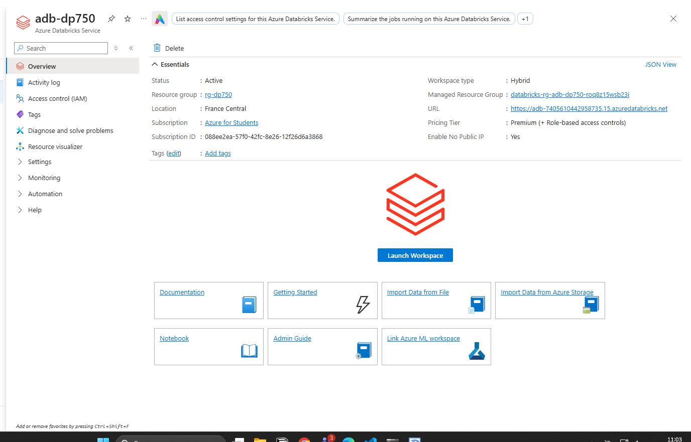
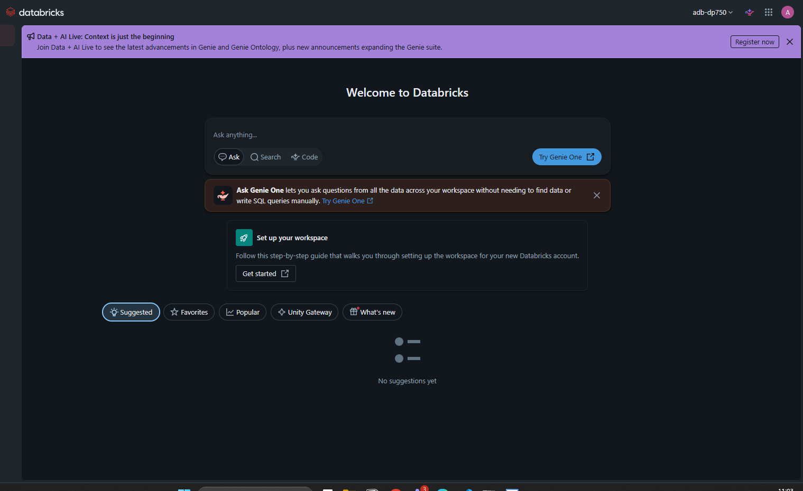

Configurar tu entorno de Azure Databricks

Antes de comenzar los laboratorios de este curso, necesitas aprovisionar un área de trabajo de Azure Databricks Premium. Este laboratorio de configuración te guía a través de ese proceso utilizando Azure Cloud Shell para que no necesites instalar ninguna herramienta localmente.

Esta configuración debería tomar aproximadamente 15 minutos en completarse.

Aprovisionar un área de trabajo de Azure Databricks Premium

Utilizarás un único script de Azure CLI en Cloud Shell para crear un grupo de recursos y un área de trabajo de Azure Databricks Premium en una región de Azure seleccionada al azar.

Tarea 1: Abrir Azure Cloud Shell

Inicia sesión en el portal de Azure en https://portal.azure.com utilizando las credenciales proporcionadas.

Selecciona el botón Cloud Shell (>_) en la barra de herramientas en la parte superior del portal. Si se te solicita, selecciona Bash como el tipo de shell.

NOTA:
Si el botón de Cloud Shell no es visible, la ventana de tu navegador podría ser demasiado estrecha. Intenta expandir la ventana o navega directamente a https://shell.azure.com para abrir Cloud Shell en una pestaña completa del navegador.

Si es la primera vez que usas Cloud Shell, se te pedirá que configures una cuenta de almacenamiento. Selecciona No se requiere cuenta de almacenamiento (No storage account required), elige tu suscripción y selecciona Aplicar (Apply).

Espera a que aparezca el prompt de Cloud Shell. Debería verse así:

yourname@Azure:~$

Tarea 2: Ejecutar el script de aprovisionamiento

En Cloud Shell, ejecuta el siguiente comando para descargar y ejecutar el script de configuración:

curl -sL https://raw.githubusercontent.com/MicrosoftLearning/DP-750T00-Implement-Data-Engineering-Solutions-using-Azure-Databricks/refs/heads/main/Instructions/Labs/00-setup.sh | bash

Espera a que termine la implementación. Esto tomará aproximadamente 5 minutos. Una vez finalizado, verás un mensaje de confirmación en formato JSON indicando que la instalación ha concluido.

NOTA:
La región se elige al azar de una lista de regiones públicas de Azure compatibles. El nombre del área de trabajo y del grupo de recursos son fijos para que puedas encontrarlos fácilmente en laboratorios posteriores.

Tarea 3: Abrir el área de trabajo de Azure Databricks

En el portal de Azure, busca Azure Databricks en la barra de búsqueda superior y selecciónalo.

Selecciona el área de trabajo adb-dp750 de la lista.

En la página de resumen del área de trabajo, selecciona Launch Workspace (Iniciar área de trabajo). La interfaz de usuario de Azure Databricks se abrirá en una nueva pestaña del navegador.

Confirma que puedes ver la página de inicio de Azure Databricks. Ahora estás listo para comenzar con los laboratorios del curso.

IMPORTANTE:
Mantén anotado el nombre del grupo de recursos rg-dp750. Lo necesitarás si deseas limpiar (eliminar) los recursos después de finalizar el curso.
